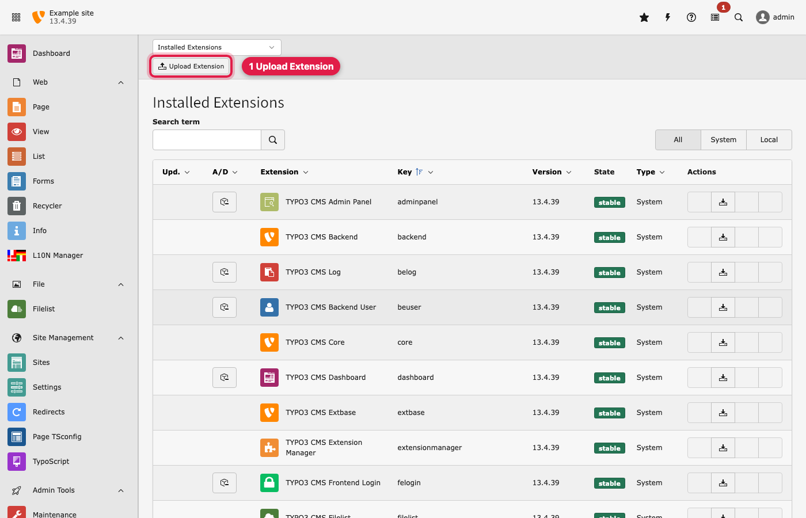
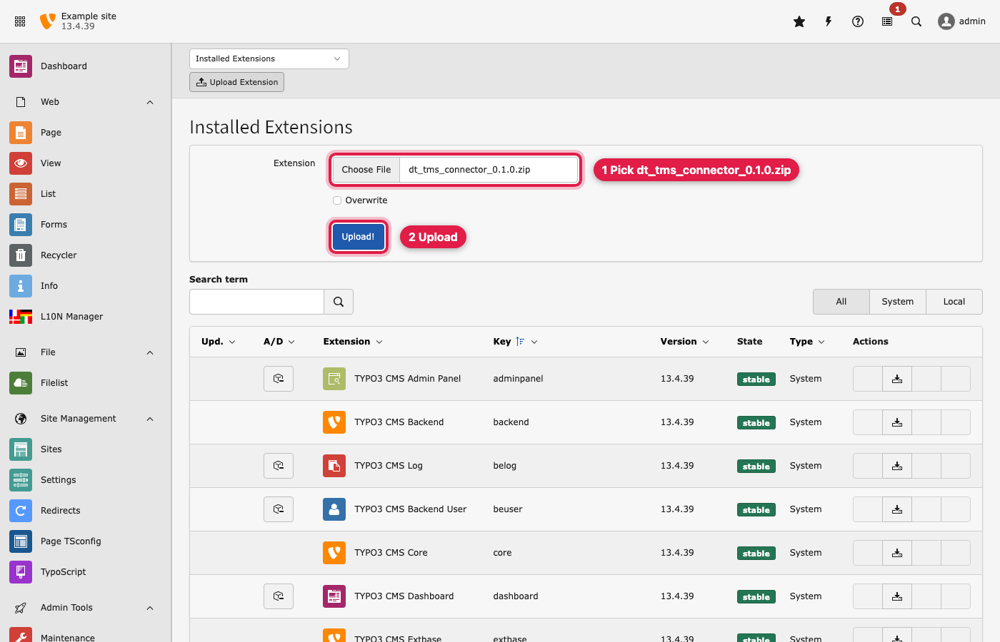
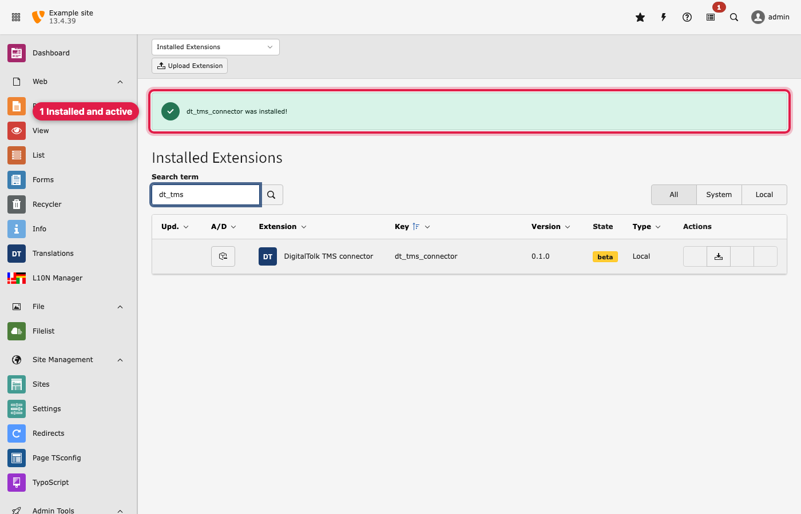
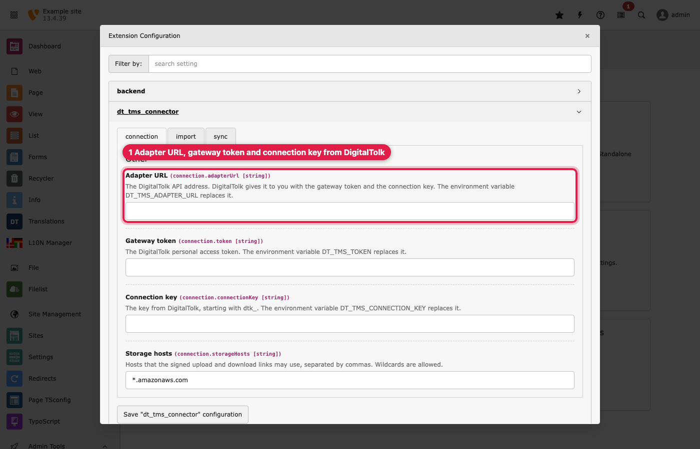
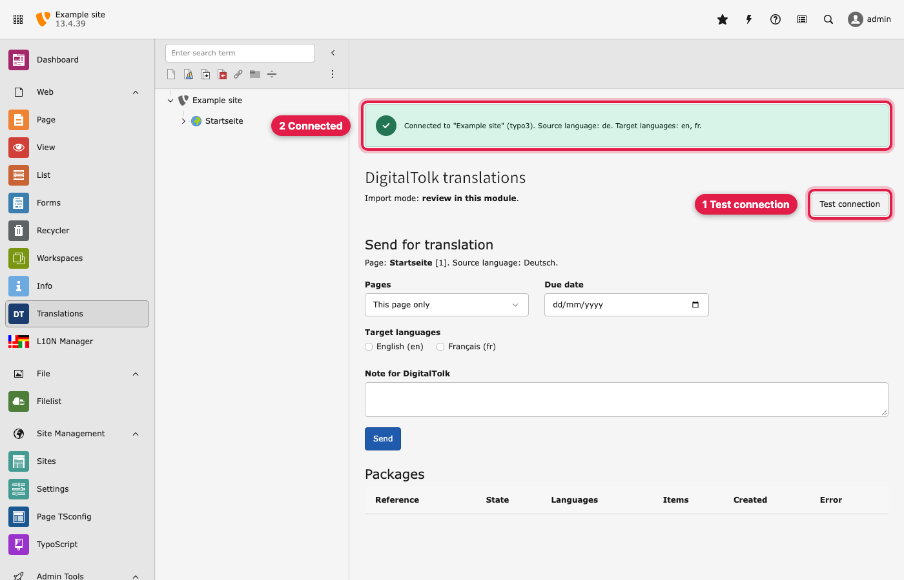
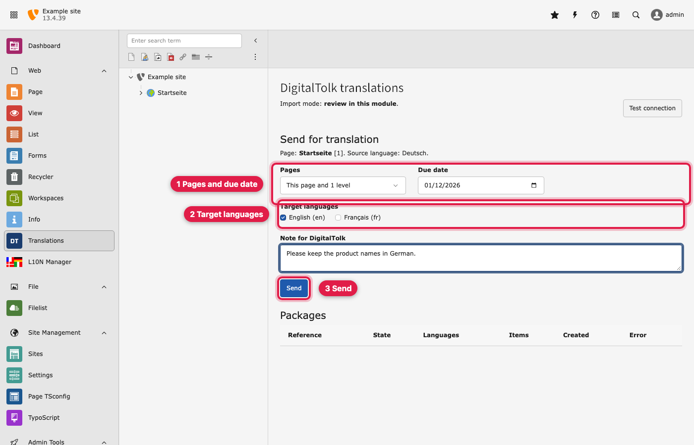
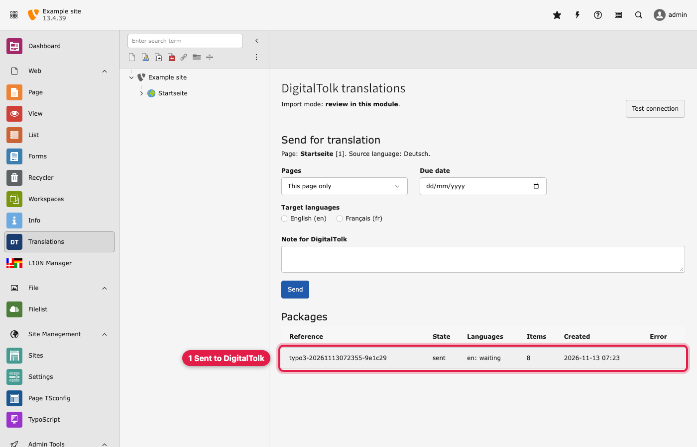
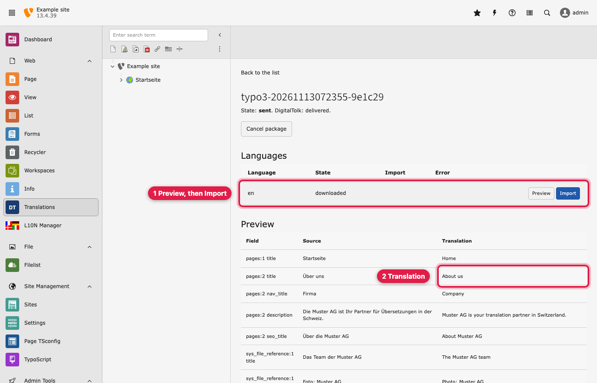
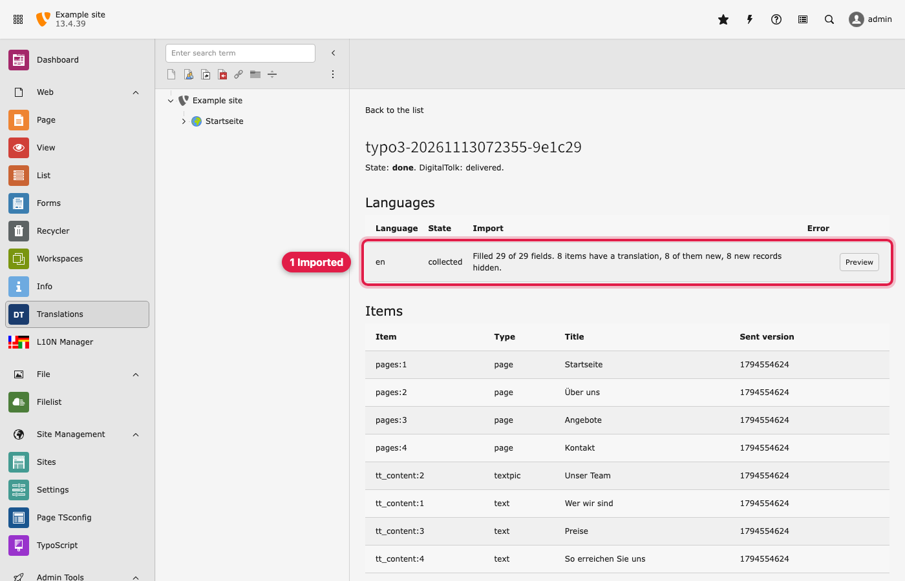
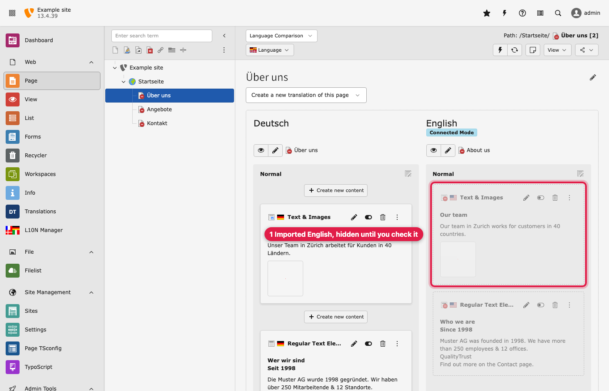

# DigitalTolk TMS connector for TYPO3

The extension sends TYPO3 pages to [DigitalTolk](https://www.digitaltolk.com) for translation and imports the translations. It uses the export and import of the Localization Manager (`l10nmgr`).

- Extension key: `dt_tms_connector`. Composer package: `digitaltolk/dt-tms-connector`.
- TYPO3 12.4 or 13.4, PHP 8.3 or 8.4, `localizationteam/l10nmgr` ^13. `l10nmgr` 13 needs the PHP `ftp` extension.
- You need a DigitalTolk account. DigitalTolk gives you the API address, a gateway token and a connection key.

## How it works

1. An editor opens Web, Translations, picks a page and a depth, picks the target languages, and clicks Send. The module stores the package as `queued`.
2. The command `dttms:sync` exports the pages with `l10nmgr` (CATXML, for the first target language). It uploads the file to DigitalTolk and completes the package with one item for each page and content element.
3. DigitalTolk translates the package. The sync polls the package status. If DigitalTolk calls the site back, the next sync polls that package at once.
4. When a language is ready, the sync downloads the file. The language waits in the module as `downloaded`.
5. The editor previews the translation and clicks Import. The next sync exports a fresh skeleton for that language, fills it from the translation, and imports it with `l10nmgr`. Then it reports the language as imported.

The module flags items that changed or were removed after sending. Their translations are based on an older version.

### Why a fresh skeleton

The `l10nmgr` export writes keys such as `NEW/1/7` for missing translations. An import with old `NEW` keys deletes an existing translation and creates it again. So the sync exports again for each target language and copies the translated text into that export by table, record and field. One file from DigitalTolk then serves every target language. Fields that hold only a number in the fresh export, such as file references, keep their value.

### Import modes

- **Review in the module** (default): an editor imports each language. New page and content translations are imported hidden, so an editor can check them before they go live. Updates of existing translations go live at once, because `l10nmgr` writes them directly.
- **Workspace**: the sync imports each language at once into the configured workspace. Editors publish through the TYPO3 workspace workflow.

## Install

Each release is one ZIP file, `dt_tms_connector_<version>.zip`. DigitalTolk sends it to you, and every [GitHub release](https://github.com/DigitalTolk/dt-tms-connector/releases) has it attached. You need no account, hosting or token to install it. Updates are manual: you install the new ZIP.

### A. Site with Composer: artifact folder (recommended)

1. Put the ZIP into a folder of the project, for example `packages/zip/`.
2. Declare the folder once as a Composer artifact repository:
   ```
   composer config repositories.dt-tms-connector artifact ./packages/zip
   ```
3. Run `composer require digitaltolk/dt-tms-connector:^0.1`.
4. If the site pins `config.platform.php` below 8.3, raise it to 8.3.
5. Run `vendor/bin/typo3 extension:setup`.

To update, put the new ZIP into the same folder and run `composer update digitaltolk/dt-tms-connector`.

### B. Site without Composer: Extension Manager

1. Install the Localization Manager (`l10nmgr`) 13 from the TYPO3 Extension Repository first.
2. Open Admin Tools, Extensions, and click "Upload Extension".

   

3. Pick `dt_tms_connector_<version>.zip` and click "Upload!".

   

4. The Extension Manager installs and activates the extension. The module Web, Translations appears in the menu.

   

To update, upload the new ZIP and select "Overwrite". A TYPO3 site that runs with Composer cannot upload extensions in the Extension Manager. Use A there.

## Configure

1. Set the extension configuration (Settings, Extension Configuration, `dt_tms_connector`):
   - **Adapter URL**, **Gateway token** and **Connection key**: DigitalTolk gives you all three. Set them with the environment variables `DT_TMS_ADAPTER_URL`, `DT_TMS_TOKEN` and `DT_TMS_CONNECTION_KEY`, so the secrets stay out of `config/system/settings.php`. The settings fields are for sites that cannot use environment variables.
   - **Storage hosts**: the hosts that the signed upload and download links may use. The default `*.amazonaws.com` fits DigitalTolk's storage.
   - **Import mode**, **Workspace UID**, **Hide new translations** and **Poll interval**.

   

2. Add a Scheduler task "Execute console commands" for `dttms:sync`, every 5 minutes. Or run `vendor/bin/typo3 dttms:sync` from cron. On a site without Composer, the command is `typo3/sysext/core/bin/typo3 dttms:sync`.
3. Give editors access to the module Web, Translations.
4. Open the module and click Test connection. The message shows the DigitalTolk connection and its languages.

   

## Use

1. Open Web, Translations and click a page in the page tree.
2. Pick the pages (this page only, 1 or 2 levels of subpages, or all subpages) and a due date.
3. Pick the target languages. Write a note for DigitalTolk if you need to.
4. Click Send.

   

5. The next sync sends the package to DigitalTolk. The list shows the package and the state of each language.

   

6. When DigitalTolk delivers a language, its state changes to `downloaded`. Open the package and click Preview. The preview shows each field with the source and the translation.

   

7. Click Import. The next sync imports the translation, and the module shows what it filled.

   

8. In review mode, new translations are imported hidden. Check them in the Page module, then make them visible.

   

### Callback (optional)

DigitalTolk can call `https://<your site>/dt-tms/callback` when a language is delivered or cancelled. Give DigitalTolk this URL. The extension checks the `X-DT-Signature` header with the connection key, and refuses requests older than 5 minutes. A callback only marks the package for the next sync. Without callbacks, the sync polls every open package at the poll interval.

## Data sent to DigitalTolk

- The text of the pages and content elements in the package, as the `l10nmgr` export holds it.
- For each page and content element: the table and record number, the title, the page URL, the content type and the last change time.
- The source and target languages, the due date and the note that the editor writes.

The extension sends nothing else, and it calls DigitalTolk only when an editor acts or the sync runs.

## Security notes for site administrators

- Each package that an editor sends can become a paid order. Give the module only to people who may order translations. DigitalTolk can also hold every package for review before it orders.
- Keep the `l10nmgr` jobs folder outside the web root. Use the default `var/tx_l10nmgr`, do not point `baseFileStoragePath` into `public/`, and remove an old `public/uploads/tx_l10nmgr/` folder. Turn off the `l10nmgr` email and FTP options, or every export goes out that way too.
- The extension never sends "HTML" content elements, because TYPO3 prints them without escaping. On import it keeps the source text of any field where the translation adds scripts or other active HTML, and the import summary says so. For extra safety, turn on `$GLOBALS['TYPO3_CONF_VARS']['SYS']['features']['security.backend.htmlSanitizeRte'] = true`.
- Updates of existing translations go live at once. Use the import mode "workspace" if every change needs a review before it goes live.
- The extension talks to DigitalTolk over https only, with time limits, and only to the adapter host and the storage hosts. Plain http to a local host works only in the TYPO3 Development context.
- TYPO3 12.4 gets security fixes only through paid extended support (ELTS). Composer blocks the public 12.4 releases because of open security advisories.

## Notes

- The import runs as the CLI user `_cli_`, which is an admin. So the module checks the editor first: Send, Import and Cancel need edit rights on every page of the package (pages that are locked for editing are refused), modify rights on `pages`, `tt_content` and `sys_file_reference`, access to the languages, and the same workspace as the package (live in review mode).
- Editors see only packages of pages they can read.
- Hidden content elements are not sent (`--noHidden`). Hidden pages and content with a start or end time are sent, so you can translate them before they go live.
- Folders, spacers and recycler pages are not sent. Pages inside a folder are sent.
- Two target languages with the same language code (for example de-DE and de-AT) cannot go in one package.
- If DigitalTolk cannot be reached, the package stays queued and the next sync tries again. If a sync stops while it sends a package, a later sync sends the package again after 30 minutes.
- One package holds at most 2000 items.
- Each package writes its own `l10nmgr` configuration record on the site root page, named "DigitalTolk <reference>".

## Development

```
composer install
vendor/bin/phpunit
vendor/bin/phpstan analyse
vendor/bin/php-cs-fixer fix --dry-run --diff
```

The unit tests need no TYPO3 database. See [CONTRIBUTING.md](CONTRIBUTING.md).

## Release

1. Update `CHANGELOG.md` and the version in `ext_emconf.php`.
2. Push an annotated tag such as `0.2.0`.
3. The `publish` workflow writes the version into the `composer.json` of the ZIP, so the ZIP works in a Composer artifact folder. It makes a GitHub release with the ZIP attached. When the environment `ter` has the secret `TYPO3_API_TOKEN`, it also publishes the version to the TYPO3 Extension Repository.
4. Send the ZIP from the GitHub release to the customers who install it by hand.

## Security

Report security problems privately. See [SECURITY.md](SECURITY.md).

## Licence

Copyright (c) 2026 DigitalTolk.

This program is free software. You can redistribute it and modify it under the terms of the GNU General Public License, version 2 or (at your option) any later version. See [LICENSE.txt](LICENSE.txt).

TYPO3 is a registered trademark of the TYPO3 Association. This project is not affiliated with or endorsed by the TYPO3 Association.
